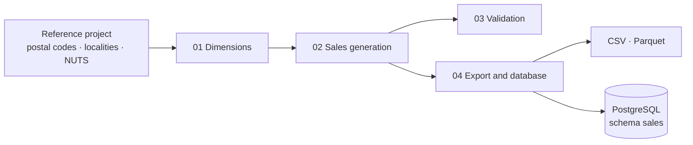
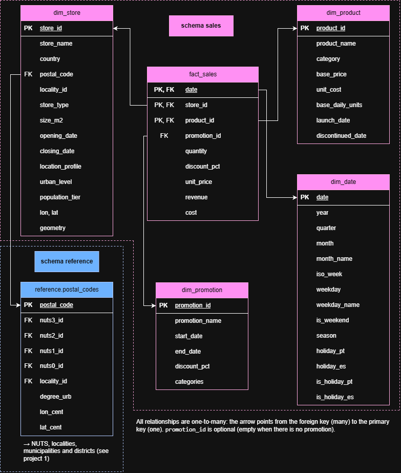

# Synthetic Sales – Sports & Outdoor Retail (Portugal and Spain)

Synthetic daily sales of **Cume & Costa**, a fictitious chain of sports and outdoor stores in Portugal and Spain, from 2021 to 2025: 52 stores, 33 products in six categories and about 1.4 million sales rows.

> **All business data in this project is synthetic.** The company, stores, products, prices, promotions and sales are invented. Only the geography (postal codes, localities and NUTS regions) is real public data, prepared in the project [postal-admin-reference-pt-es](https://github.com/biaacsaantos/postal-admin-reference-pt-es).

The goal is a realistic, reproducible dataset for analysis in **Power BI**, **SQL (PostgreSQL + PostGIS)** and **forecasting**, with patterns that can be explained: growth, expansion to Spain, seasonality by product, regional differences, weekday and opening rules, promotions and product launches.

**Tools:** Python · pandas · NumPy · PostgreSQL + PostGIS (SQL) · Power BI

---

## Pipeline



| Notebook | What it does |
|---|---|
| `01_dimensions` | Creates the stores (at real postal codes, chosen in proportion to the size of the locality), products, calendar with public holidays, and promotions |
| `02_sales_generation` | Generates the daily sales with a multiplicative model of simple factors and a Poisson distribution |
| `03_validation` | Checks with charts that every pattern built into the model appears in the data |
| `04_export_and_database` | Exports to CSV and Parquet, loads a star schema into PostgreSQL linked to the real postal codes, and runs example SQL queries |

## Data model (star schema)

The sales are stored in a star schema (schema `sales`): one fact table with the daily sales and four dimensions. Each store is linked to a real postal code of the reference project (schema `reference`, in the same PostgreSQL database), so the sales can be analysed and mapped by locality, municipality, district and NUTS region.



All relationships are one-to-many: the arrow points from the foreign key (many) to the primary key (one). `promotion_id` is optional (empty when there is no promotion).

## How the sales are generated

The expected number of units sold, for each day, store and product, is the product of simple factors:

```
expected units = product base × store base × season × geography × tourism
                 × weekday and opening days × special dates × trend
                 × store life cycle × product life cycle × promotion
```

The quantity sold is drawn from a **Poisson distribution** with that average.

| Factor | Rule |
|---|---|
| Store base | Size (m²), store type and size of the locality (population in Portugal; number of postal codes in Spain, because the Eurostat data has no population for Spanish municipalities) |
| Season | Monthly profile by category (beach in summer, snow in winter, fitness in January and September) |
| Geography | Coastal stores sell more beach products; mountain stores sell more snow products; cities sell more running and fitness |
| Tourism | Coastal stores +20% in July and August |
| Weekday | Saturday is the busiest day; street stores close on Sundays and public holidays |
| Special dates | Black Friday weekend, December before Christmas |
| Trend | +4% a year for the chain, plus a random growth for each store |
| Store life cycle | New stores reach full sales after six months; two stores close in 2024 |
| Product life cycle | E-bike, paddle board and GPS watch launched in 2022; fitness tracker discontinued in 2023 |
| Promotion | Units × (1 + 1.5 × discount) |

All the parameters are in one cell of notebook 02 and in `src/config.py`. With the fixed random seed, the data is exactly reproducible.

## How to run

1. Run the reference project [postal-admin-reference-pt-es](https://github.com/biaacsaantos/postal-admin-reference-pt-es) up to notebook 07 (CSV export). By default, both repositories are expected in the same parent folder; otherwise change `REFERENCE_CSV_DIR` in `src/config.py`.
2. Install the dependencies (with Miniforge):
   ```bash
   conda install pandas numpy pyarrow holidays matplotlib jinja2 ipykernel sqlalchemy psycopg2
   ```
   Or with pip: `pip install -r requirements.txt`
3. Run the notebooks in order, from 01 to 04. Notebook 04 needs PostgreSQL + PostGIS and, to link the stores to the postal codes, notebook 08 of the reference project.

The final tables are included in Parquet format in `outputs/parquet/`. The CSV files and the intermediate data are not stored in the repository (see `.gitignore`): they are recreated by the notebooks.

## Outputs

| Folder | Content |
|---|---|
| `outputs/csv/` | The five tables in CSV |
| `outputs/parquet/` | The same tables in Parquet (about 10× smaller; Power BI reads it with **Get data → Parquet**). **Included in this repository**, so the data can be used without running the notebooks |
| PostgreSQL, schema `sales` | Star schema with primary and foreign keys, business rules (`CHECK`) and a spatial index on the stores |

## Example SQL analyses (notebook 04)

* Revenue, margin and growth by year, and **like-for-like growth** (stores open in both years) with window functions
* Revenue by district, joining the sales with the real reference tables
* Promotion effect by category
* **Population within 15 km of each Portuguese store** with PostGIS (`ST_DWithin`)
* Top products by gross margin

## Repository structure

```
├── data/generated/   # generated tables (Parquet, not in the repository)
├── docs/             # data model diagram
├── notebooks/        # 01 to 04, run in order
├── outputs/          # parquet/ (included) and csv/ (created by the notebooks)
├── sql/              # star schema DDL and constraints
├── src/
│   ├── config.py     # parameters: period, number of stores, brand, seed
│   └── utils.py      # save and load tables
└── requirements.txt
```
